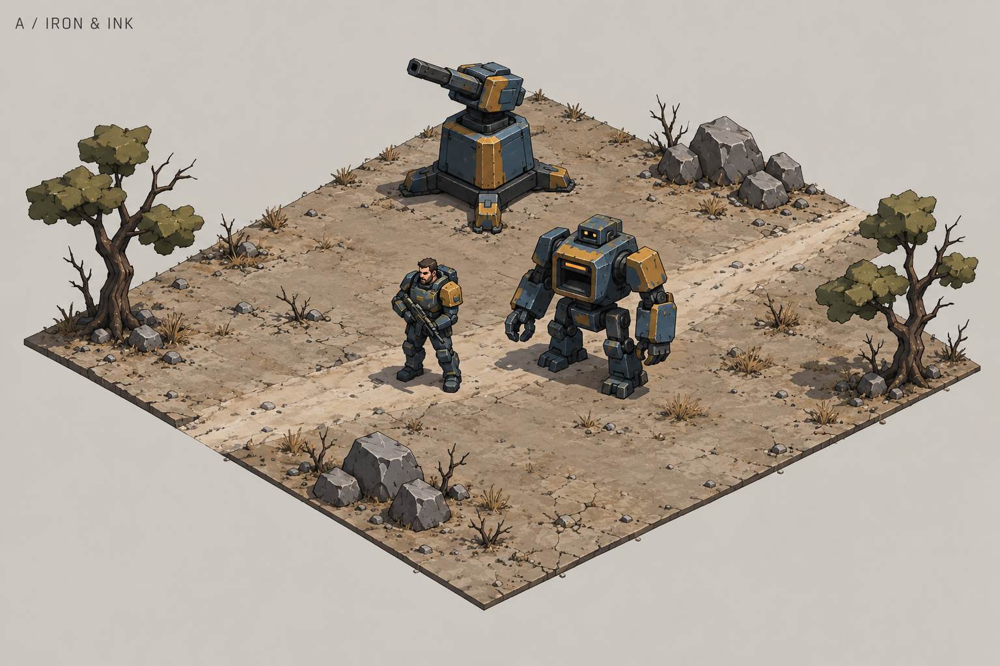

# Nathaniel concept art

Selected direction: **A / Iron & Ink**. These generated images are visual
references. Current behavior is documented in the [runtime guides](../README.md#find-the-right-files).

## Examples

| Image | Contents |
| --- | --- |
| [Original scene](iron-and-ink/01-scene.png) | Selected style: Nathaniel, Hermes, gun tower, path, rocks, and trees. |
| [Alien enemies](iron-and-ink/02-alien-enemies.png) | Grunt, soldier, boss, and spent soldier body. |
| [Human structures](iron-and-ink/03-human-structures.png) | Towers and proposed reclamation pod. |
| [Alien structures](iron-and-ink/04-alien-structures.png) | Spawner and proposed relay and bastion. |
| [Hermes anchor base](iron-and-ink/05-hermes-anchor-base.png) | Deployed hub and three connected towers. |
| [Deploy and recycle](iron-and-ink/06-hermes-deploy-recycle.png) | Mobile, deployed, and reclaimed forms. |
| [Earth homes and shops](iron-and-ink/07-earth-homes-shops.png) | Weathered and destroyed house and shop. |
| [Earth garages and warehouses](iron-and-ink/08-earth-garages-warehouses.png) | Weathered and destroyed garage and warehouse. |
| [Sandy street](iron-and-ink/09-sandy-street.png) | Standing and ruined civilian buildings. |
| [Face laser](iron-and-ink/10-hermes-face-laser.png) | Historical mobile weapon alternative. |
| [Shoulder laser](iron-and-ink/11-hermes-shoulder-laser.png) | Selected mobile emitter. |
| [Forearm laser](iron-and-ink/12-hermes-forearm-laser.png) | Historical mobile weapon alternative. |
| [Spawner crown laser](iron-and-ink/13-spawner-crown-laser.png) | Aiming crown. |
| [Soldier lance laser](iron-and-ink/14-soldier-lance-laser.png) | Integrated forearm lens. |
| [Boss siege laser](iron-and-ink/15-boss-siege-laser.png) | Protected prism and opening crest. |
| [Resource backpack](iron-and-ink/16-resource-backpack.png) | Starter arms and upgrade silhouettes. |
| [Resource collection](iron-and-ink/17-resource-collection.png) | Grab, crush, and carry. |
| [Hermes resource furnace](iron-and-ink/18-hermes-resource-furnace.png) | Transfer and contained furnace pulse. |
| [Corpse self-destruct](iron-and-ink/19-corpse-self-destruct.png) | Warning, dissolution, and disarm. |
| [Boss corpse](iron-and-ink/20-boss-corpse.png) | Collapsed shell and one-slot bundle. |
| [Grunt death](iron-and-ink/21-grunt-death.png) | Small shell explosion. |
| [Spawner death](iron-and-ink/22-spawner-death.png) | Core rupture and collapsing crown. |
| [HUD A: command shelf](iron-and-ink/23-hud-command-shelf.png) | Historical alternative. |
| [HUD B: split corners](iron-and-ink/24-hud-split-corners.png) | Historical alternative. |
| [HUD C: context ring](iron-and-ink/25-hud-context-ring.png) | Initial selected direction; controls revised below. |
| [HUD C2: Hermes ring](iron-and-ink/26-hud-hermes-ring.png) | Ability slots, Settings, and Pack up & move. |
| [HUD C2: Nathaniel ring](iron-and-ink/27-hud-nathaniel-ring.png) | Weapon toggle, Settings, and cargo gestures. |
| [Hermes grapple options](iron-and-ink/28-hermes-grapple-options.png) | Selected G1 side winch; G2 and G3 are alternatives. |
| [Hermes grapple sequence](iron-and-ink/29-hermes-grapple-sequence.png) | Clamp, disarm, reel, crush, and consume. |
| [Tech drops and collection](iron-and-ink/30-tech-collection.png) | Durable alien modules, short collector, and separate backpack cassette. |
| [Research center](iron-and-ink/31-research-center.png) | Connected analysis bench with deploy, ready, and recycle states. |
| [Research menu](iron-and-ink/32-research-menu.png) | Paused upgrade menu for desktop, tablet, and landscape phone. |

## Design notes

| Subject | Reference |
| --- | --- |
| C / Context ring HUD | [Character controls](hud-character-controls.md) |
| Deployed silhouette, connections and reclamation | [Hermes build mode](hermes-build-mode.md) |
| Selected shoulder emitter | [Hermes lasers](hermes-lasers.md) |
| Enemy emitters and contact cues | [Enemy lasers](enemy-lasers.md) |
| Backpack, disarm and furnace | [Resource gathering](resource-gathering.md) |
| Boss corpse and explosions without matter | [Enemy deaths](enemy-deaths.md) |
| Selected G1 side winch | [Automatic recovery](hermes-auto-consume.md) |
| Proposed tech resource, research center, and upgrade menu | [Tech and research](research-and-tech.md) |
| Implement tech collection and research | [Research implementation handoff](research-implementation-prompt.md) |
| Four larger survival maps and terrain stages | [Survival demo map plan](survival-maps.md) |
| Implement the selected survival maps | [Implementation handoff](survival-maps-implementation-prompt.md) |

The art, HUD, and grapple labels describe separate choices. The reclamation pod,
relay, and bastion remain proposals. Soldier variants and bosses leave collectible
matter; grunts and spawners do not. See [resource rules](../docs/resource-gathering.md)
for implemented recovery and campaign limits.
The [tech proposal](research-and-tech.md) adds durable modules to grunt and
spawner deaths without adding collectible corpses. Tech, research, and the
new menu remain concepts; their sample costs are not approved balance values.
For the survival demo, tech credit on pickup and upgrades lasting only for the
current run are confirmed design choices.

## Visual rules

- Use bold contours, large angular forms, sparse wear, and two or three values
  per material. Ground detail stays quieter than units.
- Human equipment uses petrol blue, ochre, and dark joints. Repeat Hermes's
  intake and the towers' folding feet. Reuse one tower base, with distinct gun,
  split laser emitter, and open healing mast silhouettes.
- Aliens use dark plum plates, pale edges, and small green openings. Keep the
  grunt low and wide, the soldier upright, the boss broad with one crest, and
  the spawner opening clear. Their tissue and machinery mix remains exploratory.

Sandy Earth buildings use weathered plaster and brick, cream walls, faded rust
roofs, charcoal openings, and small teal accents. Standing and destroyed pairs
share their footprint, anchor, camera, and key features. Show damage through
missing roof and wall masses, large slabs, and beams. A shared wall and roof kit
is sufficient; the sheets specify no destructible-building gameplay.

## Production and source

Use the [Blender pipeline](../docs/blender-assets.md) for calibrated projection,
world scale, canvas, and anchors. Build broad forms from boxes, wedges, cylinders,
and simple shells. Check actual gameplay size and all animation directions
before adding surface detail. These sheets are not sprite atlases or scale drawings.

[prompts.json](prompts.json) records exact imagegen prompts, refinements, dates,
and references. Image generation is not deterministic. `.gdignore` excludes the
sheets from Godot import; editable production sources belong under `art/blender/`.
