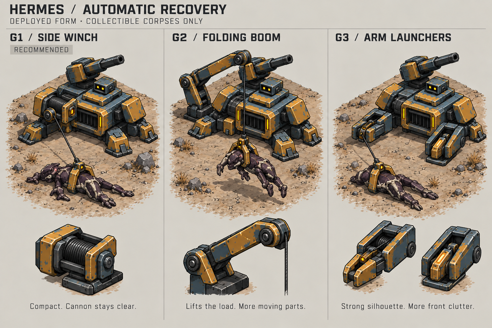
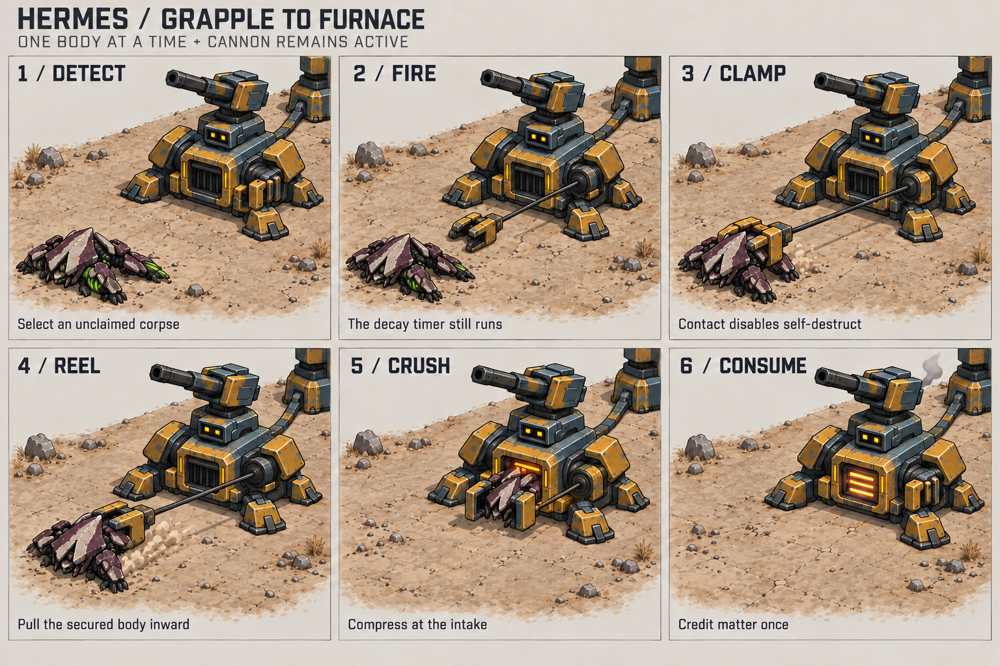

# Hermes: automatic corpse recovery

Selected design: **G1 / Side winch**, one compact mechanism beside the chest
intake. The prototype is implemented. [Resource gathering](../docs/resource-gathering.md#hermes-automatic-recovery)
defines eligibility, expiry, claim priority, shared intake, interruptions, and
saves. Timings remain initial tuning values.

## Selected appearance

G1 uses a low swivel yoke, drum, guide, and broad two-jaw clamp. G2's folding
boom and G3's arm launchers remain historical alternatives. The comparison's
“recommended” label predates G1's selection. These labels are separate from
the A / Iron & Ink art direction and C / Context ring HUD.

The side winch leaves Hermes's head and cannon clear. Its guide must reach all
sides while clearing stabilizers and tower sockets. The concept shows a
front-side pull; the saved rig uses a low orbital guide for rear and side access.
Keep the cable attached to reel and clamp throughout the pull.

Use a narrow round dark cable with a light edge. Tower connections are flat,
segmented ground conduits. Keep both distinct from lasers. The clamp launches
with a mechanical snap and uses a flat disarm contact pad like Nathaniel's:
brief amber glint, then dark alien seams.

## Motion and feedback

The boss shell shows the largest collectible. Use the same sequence for soldier
bodies: launch, clamp, ground reel, crush at the intake lip, feed, and reset.
Share the backpack's corpse and compact bundle art. Hide the mesh change behind
broad crusher plates. Use a short dust skid and contained furnace pulse; the
cannon can track and fire throughout.

Build from rigid parts and poses. Draw a cable between anchors with a shallow
bend when slack; rope physics is unnecessary. Show one body or bundle at each
phase. The existing build outline communicates range and Hermes's portrait
continues to show his combat target. Recovery adds no control.

## Review

Check rear and side approaches, all facing directions, sand, dark rubble,
connected towers, and concurrent cannon fire at normal zoom. The moving hook
must remain distinct from conduits, and contact must visibly stop the warning.
The sheets are generated concepts, not calibrated renders or animation frames.

Compare sparse fights, bursts of deaths, and mixed waves. Record bodies consumed,
rescued by Nathaniel, blocked, or expired, and measure manual delivery waits.
Tune the cycle or encounter pressure if camping pays too well. Check visibility
and launch delay before changing corpse lifetime. Reduce cable brightness and
dust if combat becomes hard to read.

Edit `art/blender/sources/hermes_anchor.blend` through the
[Blender pipeline](../docs/blender-assets.md); use the
[base study](hermes-build-mode.md) for the deployed silhouette.
[Testing](../docs/testing.md) gives the playtest procedure and platform limits.
Exact image prompts and references are in [prompts.json](prompts.json).
