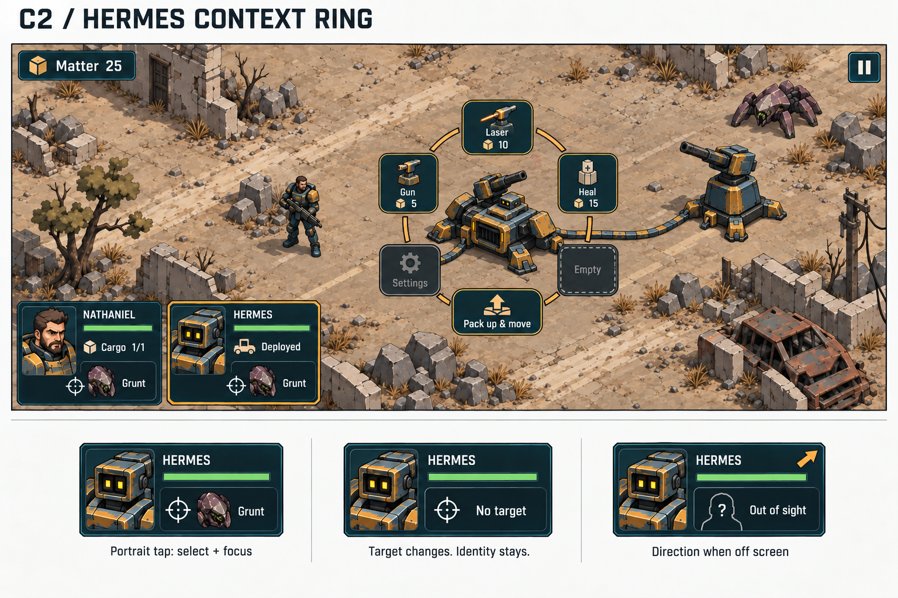
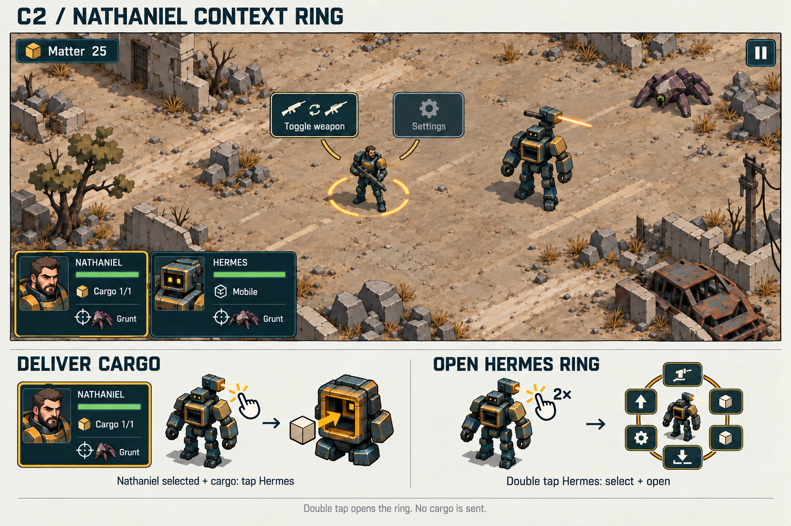

# Character controls and HUD

**Selected direction: C / Context ring.** This revision replaces the earlier
shared-shelf recommendation. The 2026-10-10 control revision keeps Nathaniel
as the controlled character. Hermes's persistent icon focuses him and opens
Build; clicking away closes it and returns to Nathaniel. There are no timed
gestures.

This is the selected design brief. The presentation implementation is in
`game_ui.gd`, `character_control.gd`, `game_input.gd`, and `game_app.gd`;
[control rules](../docs/web.md#character-controls) describe the running behavior.
The two sheets replace the controls shown in the [original C study](iron-and-ink/25-hud-context-ring.png).
A and B remain historical alternatives. Landscape phones remain the working
assumption. Portrait captures are checked; physical-device input is not yet validated.

## Hermes

Hermes has **six fixed ring positions**: Settings, Pack up & move, and four
optional ability slots. In this example the slots hold Gun, Laser, Heal, and
one unassigned position. Three towers are examples of the current abilities;
the four slots are not restricted to towers.

## Nathaniel

This sheet records the earlier two-position ring proposal. The current control
revision uses Nathaniel's body to focus him and close Build. Weapon controls remain in
the command tray; no Nathaniel tap ring opens.

## Persistent character icons

Each icon is one touch target. Nathaniel's icon **focuses him and closes Build**.
Hermes's icon **focuses him and opens Build**. This also applies when tapping
the target image inside it. Repeated Hermes icon taps keep Build open. Icons
never deliver, switch weapons, deploy, pack up, or change an enemy target.
There are no separate embedded command buttons.

Keep the friendly character face dominant. Attach a smaller portrait of its
current target, with a crosshair and short unit name. The target portrait
changes when that character changes target; it never replaces the friendly
face. Both characters can show different targets at the same time.

- **Visible target:** show the correct unit image; optional compact target
  health must follow the same visibility rules.
- **No target:** show an empty crosshair and “No target”.
- **Hidden target:** replace its image and name with a generic “Out of sight”
  badge. Do not expose hidden identity, health, or position.
- **Friendly character off screen:** add a direction arrow to its own icon.
  It remains in the same HUD location. This arrow describes the friendly
  character, not its target; the two visibility states are independent.

Use the HUD portrait as the main target cue. Give the visible enemy body a
subtle amber tint (`#e6ad50`) for Nathaniel's target and cyan (`#65e6ed`) for
Hermes's target. The portrait crosshair uses the same character color. When
both characters target the same enemy, blend the two body tints. Clear each
character's tint when their target changes, the character or target dies,
or the enemy is hidden.
Do not draw target rings, N/H letters, or an expanding enemy-click pulse.

Use an ochre outline for Nathaniel and for Hermes while Build is active, a straight friendly health
bar, and a small cargo count on Nathaniel. Status readouts are not extra
buttons. Both icons remain available while a context ring is open.

## Tap and Build rules

“Tap” below means a world-character tap unless a persistent icon is named.
A tap acts on release. There is no double-tap timer or alternate double-tap action.

| Input and state | Result |
| --- | --- |
| Tap Nathaniel's persistent icon | Focus Nathaniel. Close Build and discard any preview. |
| Tap Hermes's persistent icon | Focus Hermes. Open Build, or keep it open. Discard any preview. |
| Tap Nathaniel | Focus Nathaniel. Close Build and discard any preview. Do not open a ring. |
| Tap outside the open build ring, including Hermes | Close Build and return to Nathaniel. Consume the tap. |
| Tap Hermes with Build closed and cargo loaded | Order cargo delivery immediately. |
| Tap Hermes with Build closed and no cargo | No action. |
| Repeat any tap | Apply the same rule; never turn delivery into Build. |

Nathaniel remains the controlled character. Hermes's icon focuses him and opens
commands. The Hermes [B] tray button and B shortcut toggle his build ring.
World taps never select Hermes. Build and tower placement temporarily disable
new Nathaniel movement, enemy targeting, fire, stop, weapon changes, and cargo
delivery commands. Existing orders and automatic combat continue.

Nathaniel's card, body, or Space closes Hermes's commands and discards uncommitted
placement. Closing Build returns the camera and manual controls to Nathaniel.
The outside closing tap is consumed; the next world input controls Nathaniel.
UI input never falls through into a world order.

A press gives immediate feedback. A drag, pinch, another control, pause, death,
or scene change cancels a held world tap. Releasing it must not issue a late
order. There is no delayed gesture state to resolve later.

## Hermes ring actions

| Position | Content | Behavior |
| --- | --- | --- |
| Upper left | Ability 1: Gun in this example | Select the ability; show its cost and availability. |
| Top | Ability 2: Laser in this example | Same slot behavior. |
| Upper right | Ability 3: Heal in this example | Same slot behavior. |
| Lower right | Ability 4: Empty in this example | Reserved, inactive position when unassigned. No plus button or invented ability. |
| Bottom | Pack up & move | Recycle the temporary base and return Hermes to mobile form. |
| Lower left | Settings | Disabled placeholder. No settings panel or working settings yet. |

Keep the positions stable when a slot is empty or unaffordable. Use a muted
outline for an empty slot. Give unavailable assigned abilities a clear reason
such as “Need more matter”; do not silently hide them. How players assign
abilities to slots is a later design decision.

Selecting a tower replaces the ring with its placement preview and a visible
Cancel control. Show the build range and cost. A valid ground tap places the
tower, deploys Hermes if needed, makes the physical connection, and returns to
Build with Hermes still framed so another tower can be placed. Drag placement
has the same result. Invalid placement gives a reason and keeps the preview.
Opening the ring itself
never deploys Hermes.

During placement, clear-ground taps attempt placement. Tapping Nathaniel
focuses him, cancels the preview, and closes Build. Tapping Hermes's icon returns
to his build ring. Cancel or Escape also returns to the ring. The next Escape
closes Build; another pauses. No resources are spent until placement succeeds.

Pack up & move is available when deployed. Show which connected structures
will be reclaimed and the actual refund before activation, using the current
game rules. When already mobile, keep that utility position disabled with
“Already mobile”. Opening or closing a ring never recycles a base.

After packing up, Hermes resumes following Nathaniel, Build closes, and the
camera and manual controls return to Nathaniel. Build does not introduce
independent Hermes movement or target assignment.

## Nathaniel actions

Nathaniel's body and icon focus him and close Build. With Build closed, use the
existing weapon, fire, and stop controls. Cargo delivery is the
contextual world interaction in the table. Collection remains automatic at
backpack reach. Settings in Hermes's ring remains an inactive placeholder.

## Screen layout and input checks

Use separate large buttons on an interrupted arc, with the character visible
through the centre. Keep Settings and Pack up & move visually distinct from
the four ability slots. Do not use narrow pie slices or small secondary hit
targets. Keep the persistent character cards and the existing HUD palette.

Frame Hermes within the usable play area when opening Build. Use a 280 ms
camera move that eases in and out when Build opens or closes, or Nathaniel is
focused. A new focus starts from the current camera position; repeated card
clicks must not restart the move. Ease any build-framing zoom over the same
interval. Commands and control availability change immediately.
Clamp the whole arrangement inside safe areas; use a short leader if it must
shift from its character. Keep button order stable and avoid moving controls
under a held finger. Opening a ring keeps combat live; it does not pause,
freeze a character, or change orders.

Aim for 48–56 logical-point primary controls and verify actual device scale.
Apple recommends at least 44 × 44 pt for touch controls; Godot viewport units
are not automatically iOS points. [Apple touch-control guidance](https://developer.apple.com/design/tips/).
Keyboard shortcuts may call the same actions, but no ring action requires
a keyboard, hover, or long press.

Before implementation acceptance, check:

- Either icon focuses from off screen, including a tap on its target portrait.
  Hermes's icon opens Build; Nathaniel's closes it. Neither issues a gameplay order.
- Nathaniel's body focuses him and closes Build without opening a ring.
- With Build closed, repeated Hermes taps order delivery with cargo and
  do nothing without cargo. Neither case may select Hermes or open a ring.
- Hermes's icon focuses him and opens his six-position ring. Repeated icon taps
  keep it open. Clicking away closes it and returns the camera and controls to
  Nathaniel; the closing click gives no world order. World Hermes never reopens it. Empty
  slots and Settings remain inactive.
- Build and placement disable new manual Nathaniel commands. Opening or closing
  Build and pausing preserve existing orders.
- A valid tap or drag placement returns to Build with Hermes framed. A rejected
  placement keeps the preview. Cancel and Escape return to Build; Pack closes it.
- Delivery works with mobile and deployed Hermes. Repeated taps, changing
  cargo, death, pause, and a moving actor do not dispatch a late release action.
- Target images update independently and obey visibility rules. Own-unit
  off-screen direction never reveals a hidden enemy.
- Target body tints match the HUD crosshairs, blend for a shared target, and
  clear on retarget, death, or fog. Enemy clicks add no ring or letter.
- Placement, overlapping actors, screen edges, notches, orientation changes,
  mouse clicks, and real touch taps do not trigger two actions.

The images are static concept sheets with illustrative values. Their touch
sizes, timing, and device behavior have not been tested in game. The exact
built-in imagegen prompts are in [prompts.json](prompts.json).
