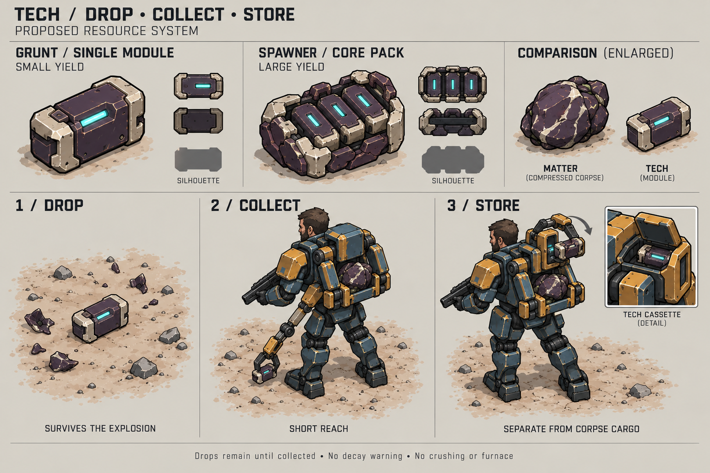
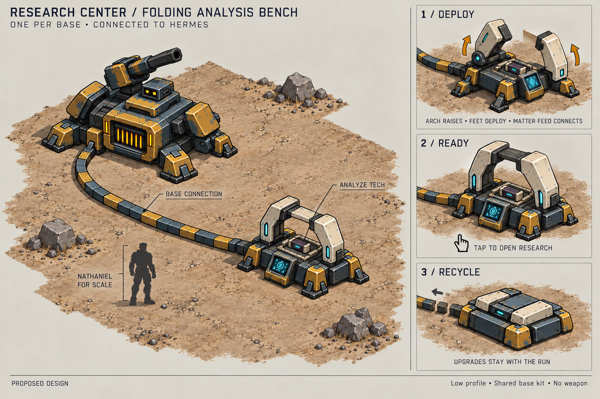
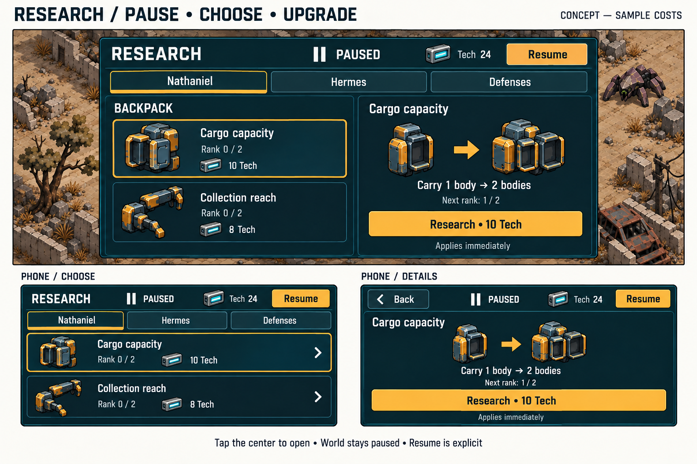

# Tech and research concepts

Tech gives Nathaniel a reason to recover alien machinery as well as bodies.
Matter builds the temporary base. Tech improves the equipment that travels
with Nathaniel and Hermes.

This is a design proposal, not implemented gameplay. The requested rules are:
grunts drop a small amount of tech; spawners drop a large amount; tech is not a
corpse and does not expire; Hermes can build one research center; tapping that
center pauses the game and opens an upgrade menu.

Confirmed for the survival demo: **credit tech as soon as Nathaniel picks it
up** and **keep researched upgrades for the current run only**. Tech needs no
delivery to Hermes. These choices avoid a second delivery inventory and keep
fresh runs comparable. All new prices and yields below are starting values
for playtests.

## T1 Tech modules and collection

Use a notched, rectangular alien component with a dark plum casing, an ivory
edge, and one small steady cyan inset. It should look manufactured. The notch
and hard outline identify it without relying on color. Matter remains an
irregular compressed body with the existing orange intake cue.

| Source | Drop shape | Proposed yield |
| --- | --- | --- |
| Grunt, including a spawner child | One small intact module. | 1 tech |
| Spawner | A larger carrier holding several modules; one pickup. | 8 tech |
| Soldier, gun soldier, boss | Keep their collectible corpse outcome. | No tech in this first design. |

Keep the existing grunt and spawner explosions. The death event creates the
tech once, at a valid nearby ground position. Transient shell fragments fade;
the intact module remains. The resource must not depend on the explosion
animation finishing. Its small landing motion is visual only.

Tech stays on the map until collected or the run ends. It has no self-destruct
timer, warning flash, dissolve, or durability. Use a steady edge highlight,
not blinking or a vertical loot beam. Neither death effect gains blast damage.

### Collection sequence

1. **Approach:** Nathaniel enters short pickup reach, or the player taps a tech
   drop to move him within reach. The pickup path must be clear of obstacles.
   Ground tech does not block movement.
2. **Clamp:** a short auxiliary collector unfolds from the upper side of the
   backpack. It has two rigid links and one broad jaw pair. The human hands
   retain the weapon. This collector can work while the main rack holds matter.
3. **Store:** the jaw places the intact module in a small side cassette and
   folds back. Credit the shared tech balance once when the pickup is accepted.
   Show one small `+1 Tech` or `+8 Tech` cue, then update the counter.

Use about 0.35 seconds for the visual sequence as a starting point. A short
servo sound and a dry double click can confirm it. Avoid crushing, furnace
fire, or a beam. Start with the existing short collection reach; the collection
reach upgrade can extend both tools.

The cassette represents collected tech. It has no separate capacity, cargo
slots, or unbanked balance in this proposal. A full matter rack does not block
tech. Nathaniel does not need a research center or a deployed Hermes to collect
it. Hermes's winch remains dedicated to corpses; its claim priority does not
extend to tech.

Automatic pickup applies only within reach; it does not pull Nathaniel off his
current route. One close pickup can include a nearby merged stack. A corpse
rescue has priority over a new tech pickup because its deadline can expire.
Tech does not interrupt an active grip or delivery. Revalidate ownership at
acceptance so repeated taps, animation callbacks, and save/load cannot duplicate
the value. If collection is interrupted before acceptance, leave the drop.

### Readability and long runs

At normal zoom, the pickup should read as a short pale bar with a dark notch.
Keep the cyan small enough that several drops do not compete with lasers.
Use the same shape in the HUD, the upgrade price, and the research tray. Show
quantity on selection or pickup instead of permanent numbers over every drop.

Merge nearby unclaimed drops into one stack while preserving the total value.
Use a capped visual stack size; a stack of 40 tech does not need 40 meshes.
Merge only within the same accessible local area. Keep drops inside the map
and reachable; never scatter or merge them across a wall. Placement must leave
tech accessible, and towers must not hide it permanently. Do not delete old
drops to control performance.

All grunts retain their tech yield, including spawned children. Keeping a
spawner alive therefore trades continuing danger for tech. Compare that income
with killing it for the larger immediate reward. Cap upgrade ranks for the
first demo and measure low-risk farming before adding a special reward limit.

## R1 The folding research center

Use a low rectangular analysis bench on the shared tower foot assembly. A
broad ivory scanner arch rises above a recessed specimen tray. The gap under
the arch is the main silhouette feature: it should remain visible when the
building is small. A cyan slot and a small sloped screen identify the tech
function. Keep it lower than Hermes and clear of his cannon and intake.

The arch has two hinged supports and one rigid crosspiece. The tray, feet,
screen, and shell use boxes and wedges. No dish, antenna array, spinning rings,
or transparent hologram is needed. Petrol blue, ochre, and dark joints connect
the building to Hermes's kit.

A broad segmented ground conduit connects it to deployed Hermes. Match the
existing tower connections; the thinner grapple cable remains distinct.
The connection is a visual dependency, not a new cable-routing puzzle.

| State | Appearance and behavior |
| --- | --- |
| Placement | Ghost footprint and short arch silhouette. Valid only within the normal build zone and placement rules. |
| Deploy | Feet open, scanner arch lifts, connection extends. |
| Ready | Arch open; small steady cyan lamp. Tap anywhere on its visible body to open Research. |
| Research purchased | Brief contained scan of the tray when play resumes; one quiet confirmation sound in the menu. |
| Recycle | Arch folds onto the tray, feet retract, connection withdraws toward Hermes. |
| Destroyed | Arch breaks inward and the lamp goes dark; no tech loot or research refund. |

The fourth Hermes build slot becomes **Research**. Start by testing a cost of
**10 matter**, no tech cost, using the normal **48 × 48** footprint and
**240-unit** build radius. Preserve terrain, overlap, and survival route checks.
Once built or reserved for construction, show **Research built** and prevent
a second center. One means one living or pending center at a time; rebuilding
after recycling or destruction is allowed.

Hermes packing up recycles the center with the rest of his base. Follow the
current matter refund rule: floor of 25% of its paid construction cost.
Destruction gives no refund. Banked tech and learned upgrades remain with the
run. Research spending is never refunded through recycling. Rebuilding restores
menu access; it does not charge again for learned ranks.

Tapping the center is a menu command, not a cargo delivery or an instruction
for Nathaniel to walk there. It works regardless of the selected character.
During active placement, a tap keeps its placement meaning. This proposal
adds no new action to the character portrait icons and does not settle the
separate differences between the old HUD concepts and current controls.

## M1 Research menu

Use an opaque petrol panel over a dim, frozen battlefield. The title,
**Paused**, available **Tech**, and **Resume** stay visible. Use the existing
ivory text and ochre selection treatment. Tech gets the notched module icon;
matter keeps its own icon. Keep texture out of text and control surfaces.

The menu supports upgrades only. Use three categories: **Nathaniel**,
**Hermes**, and **Defenses**. Each contains a short list of upgrade tracks.
There is no branching technology tree, research queue, story archive, or
research timer in this first design.

On desktop and tablet, place the list beside the selected upgrade's details.
On a narrow screen, the list occupies the full panel. Tapping a row replaces
it with a detail view. **Back** returns to the list and keeps the game paused.
The phone sheet shows landscape views; portrait, if supported, uses the same
single-column flow rather than shrinking the desktop panel.

Each detail view shows the upgrade name, current rank, exact next effect,
price, and one explicit purchase button. For example:

> Cargo capacity — Rank 0 of 2. Carry 1 body → 2 bodies.
> Research · 10 Tech

Selecting a row never buys it. The purchase applies immediately while paused,
updates the balance and rank, and stays in the menu. Use a brief **Researched**
acknowledgment. A new tap is required to buy another rank. Keep the next price
and effect visible; avoid a second confirmation dialog for these small purchases.

### Candidate upgrade tracks

The first two reuse existing backpack capabilities. The other two are new
design candidates. New tech prices are illustrative, not balance approval.
Values in the art are examples; this table defines the proposed ranks.

| Category and track | Rank 1 | Rank 2 | Proposed tech cost per rank |
| --- | --- | --- | --- |
| Nathaniel — Cargo capacity | 1 → 2 bodies | 2 → 3 bodies | 10, then 20 |
| Nathaniel — Collection reach | 44 → 60 world units | 60 → 76 world units | 8, then 16 |
| Hermes — Shoulder cooling | Mobile laser cooldown 15% below base | 25% below base in total | 12, then 24 |
| Defenses — Reinforced plating | Gun, laser, and heal tower maximum health +20% | +35% above base in total | 12, then 24 |

Cooling affects the mobile shoulder weapon, not the deployed cannon. Plating
preserves each existing tower's health fraction when maximum health changes;
buying it is not a free repair. Ranks use the original baseline, so reloading,
rebuilding, or opening the menu cannot compound the modifier.

Move the existing matter-priced backpack upgrades into this research menu
when implemented. Preserve already purchased ranks from older saves. Retire
the old purchase path so one upgrade does not have two unrelated prices.

### Menu states and input

| State | What the player sees |
| --- | --- |
| Available | Exact effect and an active `Research · 10 Tech` button. |
| Too expensive | Exact price and `Need 4 more Tech`; purchase disabled. |
| Complete | `Fully researched`, final effect, and no active purchase button. |
| Invalid or stale purchase | No spend; refresh the rank and balance with a short explanation. |
| No center | Build entry remains available; there is no research menu to open. |

Keep touch targets at least 48 logical UI pixels, separated and away from
screen edges. Use readable text, short labels, and visible focus. All actions
work by tap; keyboard navigation is optional. No hover-only description,
double tap, drag, or long press is required. Text and icons repeat color cues.
Support safe areas and text scaling. On very short screens, details scroll
above a fixed purchase control while the header stays visible.

The opening tap is consumed. Tapping the dim battlefield neither closes the
menu nor issues a world command. **Resume** closes it deliberately. Escape or
system Back returns from phone details to the list first, then closes Research.
Closing restores the prior pause state; it cannot clear an application pause,
another pause owner, or game over.

Freeze enemy AI, waves, projectiles, corpse deadlines, winch phases, collection,
and world effects. UI focus, scroll, and purchase feedback still work. A
research purchase needs an explicit permitted command while this menu owns
pause; briefly unpausing the world to call the old upgrade method is not valid.

## Persistence and production scope

Save the tech balance, ground drops and their quantities, learned ranks,
and center state with the current run. Save stable identifiers and accepted
transactions so reload cannot award the same pickup twice. Old saves start
with zero tech and preserve their existing backpack ranks. Resume keeps the
run's research. With the confirmed run-only progression, New Run and Retry
start at zero tech and baseline ranks; a spare-life respawn retains progress.
Campaign carry-over is a separate design decision.

For production, use two pickup models, one small collector and cassette on
Nathaniel, and one center with folding rigid parts. Reuse the tower feet and
conduit kit. Render through the calibrated [Blender pipeline](../docs/blender-assets.md).
The sheets approximate the camera and are not production sprites or scale
drawings. Check tech on sand, grass, and rubble, with a full cargo rack and
several simultaneous deaths. Check the center beside every tower at normal
zoom. Check the menu on a small landscape phone before fixing its final density.

These three sheets were made with the built-in imagegen tool. Exact prompts
and references are recorded in [prompts.json](prompts.json). Current behavior
remains documented in [resource gathering](../docs/resource-gathering.md)
and the [domain guide](../scripts/domain/README.md).
