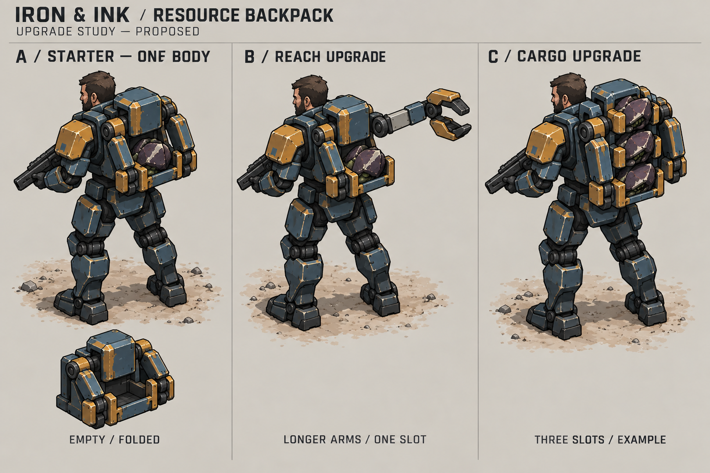
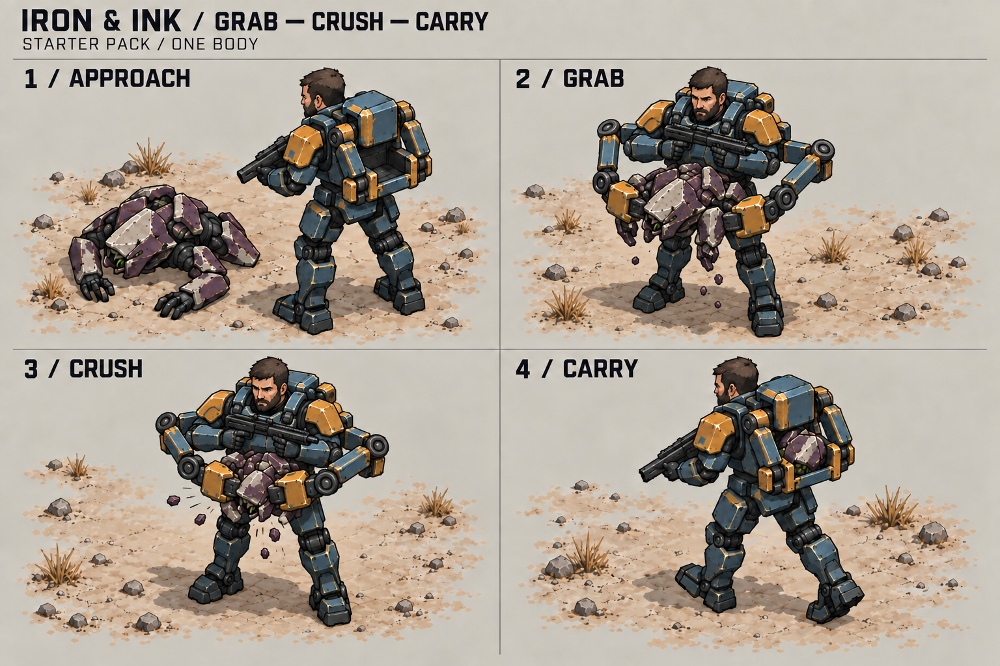
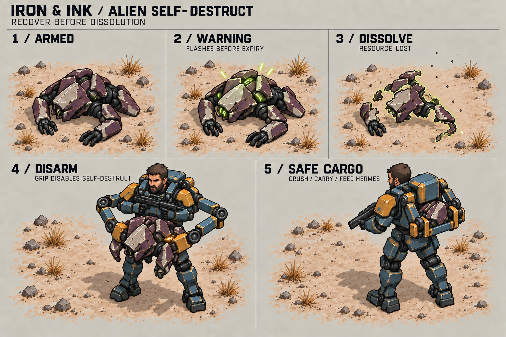
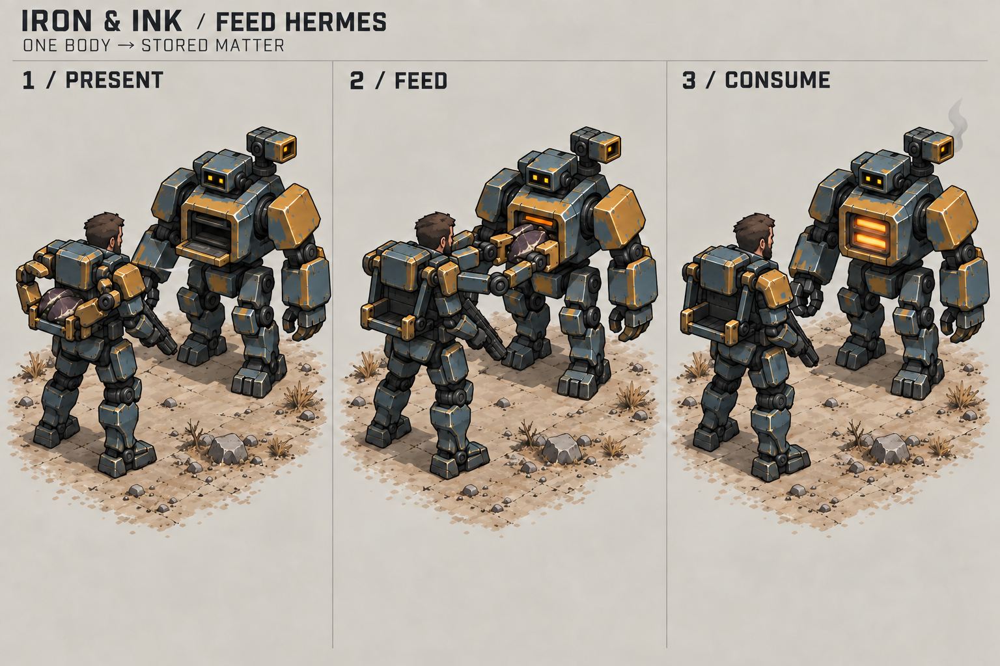

# Resource gathering: backpack and furnace

These sheets define the visual direction. [Resource gathering](../docs/resource-gathering.md)
defines implemented rules, balance sources, interruptions, and checks.

## Backpack and upgrades

Use one rigid pack, two short arms, and an open rear cargo cradle. Each arm has
two links, an elbow, and broad jaws which also crush the shell. Both arms handle
one body; extra capacity adds visible rack clamps, not another arm pair. Reach
extends the end links. The sheet's three-slot rack is a visual example; current
upgrade values live in `GameBalance`.

Fold the arms close during movement. Keep the rack below the head and within
the armored shoulder width. Leave the human arms, rifle, feet, and weapon mounts
clear. Use a rigid harness, broad shell plates, and a pale edge to keep the
bundle's origin visible. Avoid fine fingers and loose hoses.

## Grab, crush, and carry

1. **Approach:** the empty rack is visible and the arms are folded.
2. **Grab:** unfold both arms around the body, with a continuous connection to
   the pack. The clamp pad confirms successful disarm.
3. **Crush:** fold large shell pieces inward, with a small dust puff and chips.
4. **Carry:** latch the compact bundle in the cradle and fold the arms.

Empty and occupied clamps provide the capacity cue. Keep the load visible when
full. Nathaniel's human hands retain the weapon. The sheet turns him to expose
the mechanism; collection does not require that turn.

Use a few rigid poses and change from corpse to compressed form to bundle while
the jaws hide the transition. No soft-body or fracture simulation is needed.

## Corpse self-destruct

The upper row shows unattended matter loss. The lower row shows disarm and safe
cargo. [Runtime rules](../docs/resource-gathering.md#corpse-self-destruct) define
the deadline; the image does not permit rescue after dissolution.

Keep the body intact during warning. Pulse broad shell highlights and recessed
green seams without hiding its dark silhouette. Drive the phase from each body's
remaining lifetime. Make the brightness change readable among nearby corpses.

At expiry, erase coarse patches toward the central mass. A narrow green edge and
a few dry angular flecks follow the disappearing surface; the contact shadow
fades with the final piece. Leave no rubble or residue. Avoid screen flashes,
large halos, glitter, and particles which obscure units.

One flat pad inside an existing jaw gives a brief amber glint at disarm. The
warning ends immediately; carried and dropped safe matter has dark seams. Keep
the body visible through crushing. Reuse the corpse mesh and arm pivots, with a
local material pulse and coarse dissolve mask, or masked sprite frames with the
same ground anchor. No extra tool arm is needed.

## Boss matter and automatic recovery

The [boss study](enemy-deaths.md#boss-a-collapsed-heavy-shell) keeps the crest and
dark prism visible in one compressed bundle. Grunts and spawners instead explode
without collectible remains. See [runtime rules](../docs/resource-gathering.md)
for survival and campaign outcomes.

Deployed Hermes uses the selected [G1 side winch](hermes-auto-consume.md).
Its clamp, disarm cue, bundle, and furnace share this visual language.

## Feed Hermes

Use the existing rectangular chest intake in both forms, at its lower height
when deployed. Keep the head, shoulder laser, and cannon separate from it.

1. **Present:** open the lower lip; the backpack still holds the bundle.
2. **Feed:** push the bundle into the crusher ribs, then release the jaws.
3. **Consume:** withdraw the arms, close the grille, and pulse amber behind it.

Keep light inside the chamber, with a small rim reflection and optional exhaust
puff. A clamp clunk, motor strain, intake slam, and low furnace pulse can mark
the sequence. Avoid beams, flames over Nathaniel, or a glow which hides the mouth.
Feed larger racks one slot at a time. Display each bundle in only one place.

## Production

Keep the Iron & Ink palette: petrol-blue equipment, ochre clamps, dark joints,
and plum matter with pale shell edges. Use broad outlines and simple values.
Build the mechanism from boxes, wedges, and cylinders.

Edit saved `nathaniel.blend`, `hermes.blend`, and `hermes_anchor.blend` sources
under `art/blender/sources/`. Keep gathering controls separate from aim,
locomotion, and weapon mounts. Follow the [Blender pipeline](../docs/blender-assets.md)
and [weapon guide](../docs/nathaniel-weapons.md).

Check empty and full silhouettes at normal zoom, all directions, and both intake
heights. Arms must clear armor, weapons, and cargo. Generated sheets approximate
the 45-degree azimuth and 30-degree elevation; use the saved production camera
for exports. [prompts.json](prompts.json) records image prompts and references.
