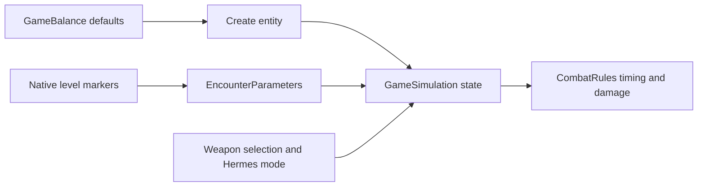

# Game balance

These are the current defaults for a fresh game, checked on 11 October 2026.
The source of truth is [GameBalance](../scripts/domain/game_balance.gd).
Update this reference when changing those values.

Distances use logical world points. Movement and projectile speeds use points
per second. The shipped grid uses 32 points per cell. Screen pixels and model
scale do not change these values. Health starts at the listed maximum.

All six shipped [levels](../levels/) use these defaults. None assigns an
`EncounterParameters` override. A saved game or debug setup can have other values.

## Characters

| Character | Maximum HP | Movement speed | Vision range |
| --- | ---: | ---: | ---: |
| Nathaniel (`nathaniel`) | 8,000 | 80 | 500 |
| Hermes, following (`hermes`) | 8,000 | 65 | 500 |
| Hermes, deployed | 8,000 | 0 while deployed | 500 |
| Grunt (`grunt`) | 150 | 70 | 800 |
| Laser soldier (`soldier`) | 200 | 40 | 300 |
| Gun soldier (`gunSoldier`) | 200 | 40 | 300 |
| Boss (`boss`) | 800 | 60 | 600 |
| Spawner (`spawner`) | 1,500 | 0 | 400 |

Hermes keeps a stored speed of 65 when deployed, but building mode stops his
movement. When following, he stops within 100 points of Nathaniel. Bosses move
toward a target until they reach 30% of their attack range: 150 points by default.
Other mobile enemies stop at their full attack range.

Vision controls target acquisition; attack range controls firing. Enemies can
keep a living target after it leaves vision. See
[targeting and movement](../scripts/domain/game_simulation.gd) and
[CombatRules](../scripts/domain/combat_rules.gd).

## Weapons

Nominal DPS means damage per second with an available target, no misses, and
continuous firing. It excludes aiming, travel time, weapon changes, target
changes, and overkill. It is a comparison value, not a playtest measurement.

| Weapon / owner | Damage | Shot interval or beam rest | Attack range | Projectile speed | Nominal DPS |
| --- | --- | --- | ---: | ---: | ---: |
| Rifle / Nathaniel | 25 per hit | 0.8 s | 450 | 450 | 31.25 |
| Heavy rifle / Nathaniel | 50 per hit | 1.6 s | 450 | 450 | 31.25 |
| Shoulder laser / following Hermes | 120 per active second | 3 s rest | 450 | Instant beam | 40 |
| Cannon / deployed Hermes | 80 per hit | 0.8 s | 300 | 650 | 100 |
| Blaster / grunt | 25 per hit | 0.8 s | 250 | 450 | 31.25 |
| Pulse lance / laser soldier | 25 per hit | 0.8 s | 300 | Instant hit | 31.25 |
| Gun / gun soldier | 25 per hit | 0.8 s | 300 | 450 | 31.25 |
| Pulse laser / boss | 25 per hit | 0.8 s | 500 | Instant hit | 31.25 |
| Beam / spawner | 75 per whole active second | 3 s rest | 350 | Instant beam | 25 over repeated bursts |

Nathaniel starts with the rifle. The heavy rifle requires a pickup. Both use
`GameBalance.WEAPONS`; Hermes's cannon uses `HERMES_ANCHORED_WEAPON`. Enemy weapons
use their entries in `STATS`.

Continuous beams fire for `LASER_BURST_SECONDS`, currently 1.5 seconds. Hermes
and spawners rest for 3 seconds, giving a nominal 4.5-second cycle. Hermes's
beam produces 180 damage per full burst, carrying fractional HP between
updates. Thus its cycle DPS is `120 * 1.5 / 4.5 = 40`. Laser towers retain
their 3.5-second rest and nominal 5-second cycle.

The spawner counts whole active seconds and carries the remainder between
bursts. Its first full burst does 75 damage. With uninterrupted targets, later
full bursts alternate 150 and 75 damage. Its long-run nominal DPS is
`75 * 1.5 / 4.5 = 25`. Its cooldown advances only while a target is in range.
Hermes and tower beams can charge their cooldown without a target.

Soldier and boss pulses apply damage once, immediately. Their 0.18-second
`LASER_PULSE_SECONDS` is a visual phase, not extra damage. Their stored
`shot_speed` values, 450 and 240, do not control these instant pulses.

Changing Nathaniel's weapon takes 0.35 seconds. His aim turns at 360 degrees per
second and must be within 1 degree before firing. A change cannot shorten the
previous shot's recovery. Weapon pickups require a distance of at most 32 points.
There is no bow in the current weapon catalog or actor defaults.

## Hermes's towers

| Tower | Cost in matter | Maximum HP | Speed | Attack / healing range | Vision | Effect | Nominal rate |
| --- | ---: | ---: | ---: | ---: | ---: | --- | --- |
| Gun (`gunTower`) | 5 | 600 | 0 | 500 | 500 | 25 damage per hit, every 0.8 s; projectile speed 450 | 31.25 DPS |
| Laser (`laserTower`) | 10 | 600 | 0 | 350 | 350 | 150 damage per active second; 1.5 s beam, 3.5 s rest | 45 DPS |
| Heal (`healTower`) | 15 | 600 | 0 | 400 | 400 | Up to 40 HP to each injured hero, every 2 s | 20 HP/s per hero; up to 40 total |

The laser tower produces 225 damage per full burst. Healing affects Nathaniel
and Hermes, not other towers. Both heroes can heal on the same tick. They must
be alive and strictly inside the healing range. An idle healing tower stays
ready. Healing stops at maximum HP. In the saved entity format, `damage` is the
healing amount and `delay` is the healing interval. The total rate is the sum
of healing delivered to both heroes; there is no separate 10-HP/s limit.

All towers have a 48-by-48-point footprint and a 24-point collision radius.
Construction requires a living Hermes and a clear position within his
240-point build range. A successful placement deploys him. Authored map towers
also deploy him and cost no matter.

Following dismantles all connected towers. Each surviving purchased tower
refunds its paid cost divided by four, rounded down: 1 matter for Gun, 2 for
Laser, and 3 for Heal at the current costs. Map towers give no refund. Hermes's
death removes all towers without a refund and ends the game.

## Other settings that affect balance

| Setting | Current value | Source |
| --- | --- | --- |
| Spare lives | Campaign: 3; Survival: 0 | Level `Definition` resources |
| Starting matter | Levels 0–3: 30; levels 4–5: 0 | Level `Definition` resources |
| Matter per delivered body | Soldier, gun soldier, boss: 10 each | `GameBalance.RESOURCE_VALUES` |
| Kill score | Grunt: 20; both soldiers: 30; boss and spawner: 100 | `GameBalance.STATS` |
| Hermes follow distance | 100 points | `GameBalance.HERMES_FOLLOW_DISTANCE` |
| Boss approach distance | 30% of attack range | `GameBalance.BOSS_APPROACH_RANGE_RATIO` |
| Spawner production | Three initial grunts, 30 s apart; then one every 120 s | `GameBalance.SPAWNER_INITIAL_SPAWNS`, `SPAWNER_INITIAL_INTERVAL_SECONDS`, `SPAWNER_INTERVAL_SECONDS` |
| Spawner child offset | `(240, -168)` logical points | `GameBalance.SPAWNER_SPAWN_OFFSET` |
| Wave interval and selection count | Stage table below | `GameBalance.WAVE_STAGES` |
| Cargo capacity | 1 / 2 / 3 bodies; upgrades cost 20 / 40 | `GameBalance.RESOURCE_CAPACITIES`, `RESOURCE_CAPACITY_COSTS` |
| Pickup reach | 44 / 60 / 76 points; upgrades cost 15 / 30 | `GameBalance.RESOURCE_REACHES`, `RESOURCE_REACH_COSTS` |
| Loose body lifetime | 10 s; warning at 3 s remaining | `GameBalance.RESOURCE_LIFETIME_SECONDS`, `RESOURCE_WARNING_SECONDS` |

| After elapsed time | Spawn interval | Enemy selection count |
| --- | ---: | ---: |
| Start | 5 s | 2 |
| 60 s | 4 s | 3 |
| 120 s | 3 s | 4 |
| 180 s | 2 s | 5 |
| 240 s | 1 s | 6 |
| 300 s | 1 s | 7 |

Wave thresholds use strict `>` comparisons: exactly 60 seconds still uses the
5-second interval and two choices. Selection indexes are grunt, soldier,
spawner, boss, then three extra soldier entries. Soldier choices split equally
between laser and gun soldiers. See
[BattlefieldRules](../scripts/domain/battlefield_rules.gd) when tuning encounters.

## Balance observations

These are numerical comparisons. They do not establish difficulty or intended
character roles without playtests.

- The heavy rifle doubles damage and doubles its interval. It has the same
  sustained DPS as the rifle. It needs 3 hits for a grunt instead of 6, and
  4 hits for a soldier instead of 8. A miss or excess damage costs more time.
- Deployed Hermes has 3.2 times Nathaniel's nominal rifle DPS. Deployment
  reduces his attack range from 450 to 300 and stops movement.
- A laser tower has 45 cycle DPS versus 31.25 for a gun tower. The gun has
  greater range and half the cost. Per matter, that is 6.25 nominal DPS for
  the gun versus 4.5 for the laser. The beam avoids projectile travel and misses; current
  combat adds no area damage or armor bonus to compensate.
- At 25 damage per hit, each hero takes 320 hits from full health. A single heal
  tower would need about 6 minutes 40 seconds to restore either hero's full HP
  pool without damage.
- Nathaniel moves faster than the 70-point-per-second grunt. Hermes moves at
  65 points per second, so he still trails Nathaniel while following.
- The boss has more HP, speed and range than a soldier, with the same nominal
  attack DPS. Its chase distance also brings it closer than its firing range.

## Code layout and finding the data

The main boundaries are clear. Shared stats live in one small domain file.
Combat owns damage timing. The simulation owns entity state and mode changes.
Level adapters carry encounter overrides into the domain. Visual resources do
not own gameplay damage or distance. Keep this structure for balance work.

| Need | Edit / inspect | Important rule |
| --- | --- | --- |
| Shared health, speed, vision, enemy and tower attacks | [game_balance.gd](../scripts/domain/game_balance.gd), `STATS` | Fresh entities copy these values |
| Nathaniel's weapons | Same file, `WEAPONS` | Startup and equipment changes use this catalog |
| Deployed Hermes | Same file, `HERMES_ANCHORED_WEAPON` | Deployment replaces the mobile weapon profile |
| Tower cost and build radius | Same file, `COSTS`, `HERMES_BUILD_RANGE` | Cost is separate from the tower stat entry |
| Beam duration | Same file, `LASER_BURST_SECONDS` | Shared by Hermes, laser towers and spawners |
| One authored enemy or tower | Level marker's `Parameters` resource | `-1` retains the shared default |
| Follow and boss approach distances | Same file, `HERMES_FOLLOW_DISTANCE`, `BOSS_APPROACH_RANGE_RATIO` | Distances remain in logical world units |
| Spawner cadence and child position | Same file, `SPAWNER_*` | New spawners use the initial settings; saved countdowns persist |
| Wave pressure | Same file, `WAVE_STAGES` | Keep stages in ascending time order; thresholds use strict `>` |
| Saved stats and mode changes | [game_simulation.gd](../scripts/domain/game_simulation.gd) | Restore keeps most stored stats and refreshes Hermes's weapon |

### Changes made with this reference

The README task map now has a direct balance entry. The domain guide links
here. `GameBalance` now documents the units and the different meanings of
`damage` and `delay`.

Beam duration moved from two `1.5` literals in combat to
`GameBalance.LASER_BURST_SECONDS`, with the same value. Healing now reads its
configured `damage` and `delay`; previously, combat always used 5 HP and 1 second.
Zero healing amount now produces no healing events. A regression scenario
checks a 12-HP, 0.5-second authored tower and a zero-amount override. That
preparation preserved the then-current healing and beam defaults.

Follow distance, boss approach ratio, spawner count/cadence/offset and wave
stages now live in `GameBalance`. Wave intervals and selection counts share one
stage table. The runtime keeps the existing threshold and random selection rules.

The Inspector shows `Parameters` only on enemies and towers. Switching marker
kind preserves the resource for serialization. An attached resource on a hero,
objective or weapon pickup produces a warning about unused overrides.

The gameplay and weapon suites now use starting HP, configured damage and
captured save state for rule assertions. Healing and shot-timing scenarios use
explicit inputs where a known cadence is needed. Exact rifle catalog checks
are grouped in `_test_starting_weapon_balance`. Wave checks cover before, at
and after each stage threshold. Content checks cover Inspector visibility,
resource preservation and warnings for every marker kind.

### Editing and testing

The main discovery problem is field meaning, not file placement. `damage` can
mean damage per hit, damage per active second, or healing per tick. `delay` can
mean shot interval, beam rest, or healing interval. This reference and the source
comments make that distinction explicit. Keep saved names stable; a new resource
system is not needed for this work.

Edit shared hero stats in `GameBalance`; hero markers set start positions only.
Use marker overrides for one enemy or tower. In other rule suites, follow the
same test pattern when editing a scenario: compare damage and movement with
the starting state, or supply explicit inputs for a timing contract. Keep exact
catalog assertions in explicit balance checks.

Saved entities retain most stored stats. Hermes's weapon profile is refreshed
on restore; changing Nathaniel's weapon also reads the current catalog. For
consistent comparisons, start a fresh level after editing defaults. Do not use
a saved game as evidence that every new value has applied.

Run `rtk make format-check test-gameplay test-content` after a balance edit.
Use [testing](testing.md) for playtests and isolated saves. Build success and
headless rule checks do not establish platform input or game difficulty.

## Verification for balance preparation

On 11 October 2026, `rtk make format-check test-gameplay test-content` passed:
344 gameplay assertions, 108 weapon checks and 214 content checks. The full
`rtk make test` regression suite also passed on rerun. Local Markdown links and
`rtk git diff --check` passed.

A temporary headless comparison against the prior Git revision passed 1,840
checks. Character/weapon profiles, tower costs and Hermes's cannon values were
identical. For three seeds at twelve elapsed times, fifty wave selections each
kept the same enemy kind, position and random state. Wave intervals also matched.

An earlier full run reported a resource leak at presentation-test shutdown,
after all 231 presentation assertions passed. An isolated verbose run and the
subsequent full suite passed without that leak. Its cause was not established.

The healing override scenario failed before the earlier healing fix and passed
after it. No difficulty playtest, platform export, or real mouse/touch control
check was run for this preparation. The DPS comparisons above are calculated
from the rules.

## Hero health and speed update

Both heroes now start with 8,000 HP. Nathaniel moves at 80 logical points per
second; following Hermes moves at 65. Deployed Hermes remains stationary.
Start a fresh level to apply these defaults; existing snapshots retain saved
health and movement values.

`rtk make format-check test-gameplay` and the full `rtk make test` suite passed
for this update. Resource death scenarios now use Hermes's current HP when
testing lethal damage.

## Healing tower update

Each heal tower restores up to 40 HP to each injured hero every 2 seconds:
20 HP/s per hero, or 40 HP/s combined while both receive healing. Each tower
applies its own healing; there is no shared rate limit. Healing still stops
at each hero's maximum HP. Start a fresh level and build a tower to use the
new defaults; existing saved towers retain their stored healing settings.

Format and gameplay checks passed. Healing checks passed all 42 headless and
53 rendered assertions, including the two-second wait, 40 HP per hero and
separate recipient feedback. The full `rtk make test` suite passed after an
older feedback test was updated to use the configured healing interval.

## Laser DPS update

Following Hermes now has 40 nominal cycle DPS: 120 damage per active second,
1.5 seconds firing and 3 seconds resting. His deployed cannon stays at 100 DPS.
The boss now fires one 25-HP pulse every 0.8 seconds for 31.25 DPS. Spawners
deal 75 damage per whole active second with a 3-second rest, averaging 25 DPS
across repeated bursts. These settings keep hit damage in whole HP; beam
duration remains 1.5 seconds. Start a fresh level to apply all three profiles.

Format, gameplay, laser combat and rendered emitter checks passed. A temporary
headless check confirmed 360 HP over 9 seconds for Hermes, 50 HP over 1.6 seconds
for the boss, and 225 HP over 9 seconds for the spawner at 30, 60 and 120 FPS.
The full `rtk make test` regression suite passed.

## Laser tower DPS update

Laser towers now deal 150 damage per active second. A 1.5-second burst produces
225 damage, followed by 3.5 seconds of rest: `225 / 5 = 45` nominal DPS.
New towers use these settings; existing saved towers retain their stored values.

Format and gameplay checks passed. Laser tower checks passed 213 headless and
229 rendered assertions. A temporary headless check measured 450 damage over
two cycles at 30, 60 and 120 FPS, giving 45 DPS in each case.
The full `rtk make test` regression suite passed.
